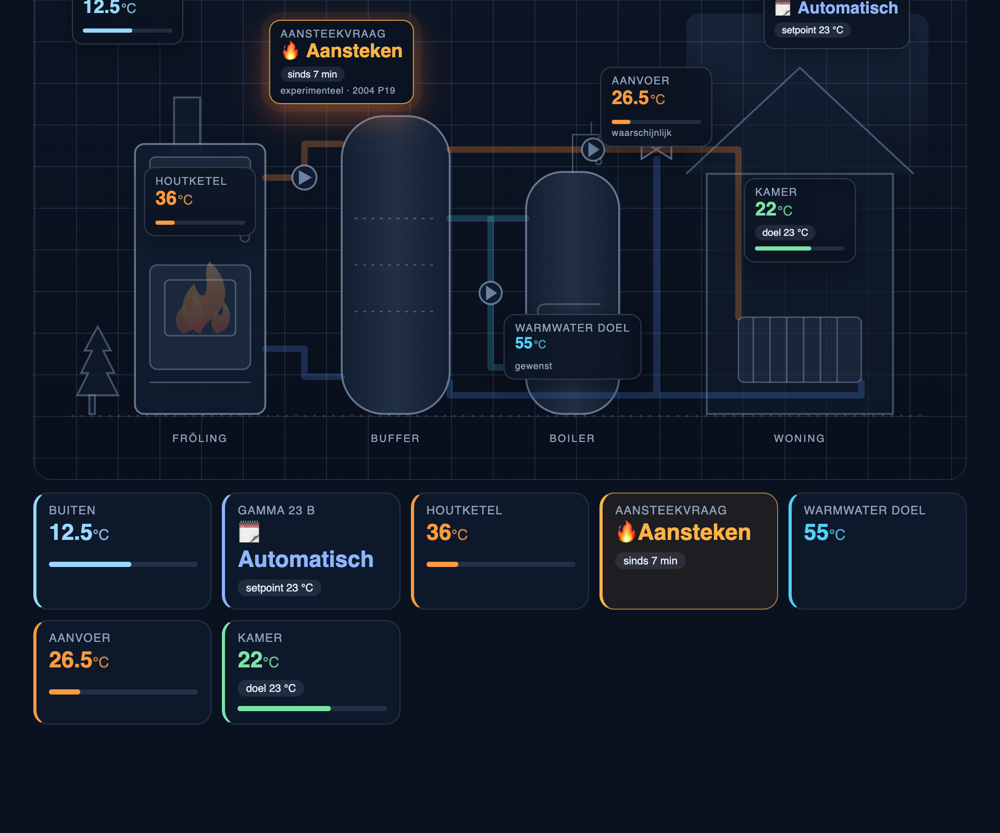

# froeling-gamma-card

Lovelace-kaart voor Home Assistant die de technische installatie schematisch toont:
Fröling houtketel → buffervat → menggroep → radiatoren, plus de warmwaterboiler.
Live waarden van de EBV Gamma 23 B (via [gamma2mqtt](../gamma2mqtt)) staan als chips op de
plek waar ze horen; leidingen animeren als er stroming is en de ketel toont vuur als hij heet is.
De **aansteekvraag** (het vlammetje op het Gamma-display) licht oranje op.

## Installatie

**HACS (aanbevolen):** HACS → Frontend → ⋮ → *Custom repositories* → URL van deze repo,
categorie *Dashboard*. Daarna de kaart installeren; HACS registreert de resource zelf.

**Handmatig:** kopieer `dist/froeling-gamma-card.js` naar `config/www/` en voeg onder
*Instellingen → Dashboards → ⋮ → Resources* toe: `/local/froeling-gamma-card.js` (JavaScript-module).

## Configuratie

Zie [`example-dashboard.yaml`](example-dashboard.yaml). Alle entiteiten hebben als standaard de
ids die gamma2mqtt aanmaakt (`sensor.gamma_*`), dus `type: custom:froeling-gamma-card` zonder
verdere opties werkt al.

| Optie | Standaard | Betekenis |
|---|---|---|
| `title` | `Verwarming` | Kop van de kaart (`show_header: false` verbergt hem) |
| `show_tiles` | `true` | Tegelrij onder het schema |
| `entities.*` | `sensor.gamma_*` | Zie voorbeeld; `buffer_top`, `buffer_bottom`, `hot_water`, `boiler_pump`, `hot_water_pump` zijn optioneel (UVS 42) |
| `thresholds.flow_active` | `28` | Aanvoertemperatuur waarboven het cv-circuit animeert |
| `thresholds.boiler_active` | `60` | Keteltemperatuur waarboven vuur en laadpomp animeren (alleen zonder `boiler_pump`) |

Klikken op een chip of tegel opent de *more-info* dialoog van die entiteit.
Als `binary_sensor.gamma_flame_request` de attribute `confidence: candidate` heeft, toont de kaart
"experimenteel · 2004 P19" onder de aansteekvraag.

## Ontwikkelen

Geen build-stap. Open `dev/preview.html` in een browser; het laadt `dist/froeling-gamma-card.js`
met een mock `hass`-object en knoppen voor vier scenario's (vlam aan, ketel heet, met UVS 42, offline).
Coördinaten van de chips staan in `CHIPS` (viewBox 1000×560) en moeten gelijk lopen met de SVG in `sceneSvg()`.
